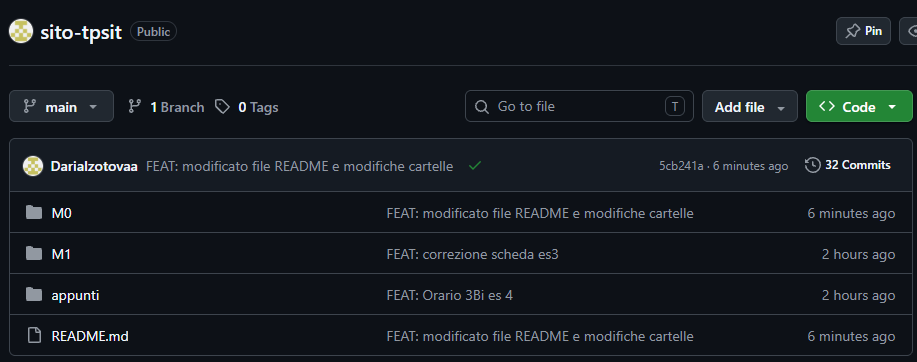

# SITO-TPSIT

È il progetto personale del Laboratorio di TPSIT della classe 3Bi, costruito lungo tutto l'anno scolastico 2026/2027.

## Che cos'è

Il repository contiene esercizi del modulo M0, appunti del modulo M1 e esercizi del modulo M1, della materia TPSIT.

È un progetto didattico, serve per imparare ad usare Git, GitHub e VS Code.

## Come si consulta

Il repository contiene gli appunti delle lezioni in laboratorio e gli esercizi dei moduli M0 e M1, che si leggono aprendo i file della cartella
`M0` e della cartella `appunti` direttamente su GitHub.

1. Clona il repository sul tuo PC:
   ```bash
   git clone https://github.com/DariaIzotovaa/sito-tpsit.git
   ```
2. Apri una cartella:
- `M0` per gli esercizi del modulo M0
- `M1` per gli appunti del modulo M1
- `appunti` per gli esercizi del modulo M1
3. Clicca su un qualsiasi file per vedere il contenuto.


## Come è organizzato

| Cartella o file | Contenuto |
|---|---|
| `M0` | esercizi del modulo M0 |
| `M1` | appunti del modulo M1 |
| `appunti` | esercizi del modulo M1 |
|`README.md`| questo file|

## Strumenti usati

- Git per il controllo di versione
- GitHub per la pubblicazione
- Codespace (o Visual Studio Code) come editor

## Stato del lavoro

- [x] repository creato e collegato a GitHub
- [x] file di descrizione del progetto
- [ ] termine esercizi M1

## Autrice e contesto

Daria Izotova, classe 3Bi, ITT Marconi Rovereto.
Lavoro svolto per il corso di Laboratorio di TPSIT, anno scolastico 2026/2027.

## Collegamenti

[Appunti di markdown](./appunti/appunti-markdown.md)  
[Scheda album MDB](./appunti/scheda.md)  
[Orario classe 3Bi](./appunti/orario.md)  

Screenshot della pagina del mio repository sito-tpsit su GitHub